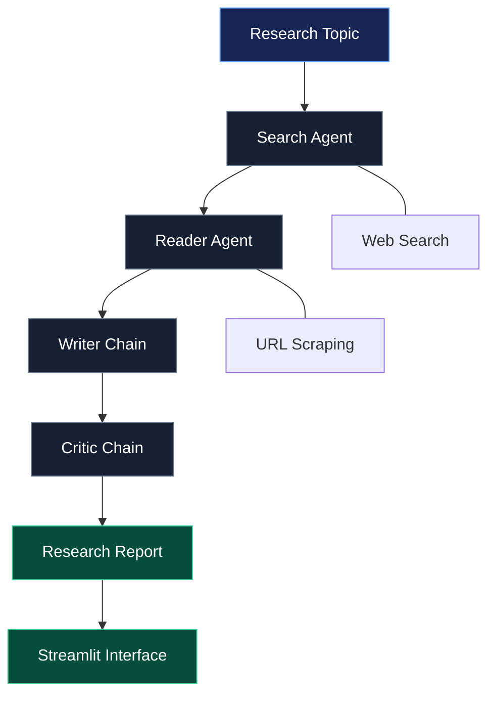

# Multi-Agent AI Research System

**From a research question to a structured report — powered by collaborating AI agents.**

An AI-powered research application that decomposes the research process into specialized stages: web search, content extraction, report generation, and critical review. Built with Python and LangChain, with a Streamlit interface for running the workflow and exploring the results.

---

## Overview

Research often involves jumping between search engines, reading lengthy articles, collecting relevant information, organizing findings, and reviewing the final output.

The Multi-Agent AI Research System brings these steps into a single workflow. Instead of relying on one LLM call to do everything, it uses specialized agents and chains to handle different responsibilities.

The goal is simple: **make AI-assisted research more structured, transparent, and useful.**

## How It Works



### The research pipeline

**01 — Search Agent**

Finds relevant web sources for the given topic using web-search tools.

**02 — Reader Agent**

Extracts and processes useful information from selected URLs to build research context.

**03 — Writer Chain**

Transforms the collected material into a structured research report.

**04 — Critic Chain**

Reviews the generated report and provides feedback to support quality assessment.

**05 — Streamlit Interface**

Provides a visual interface for submitting topics, following pipeline progress, reviewing results, and accessing generated reports.

---

## Features

- **Multi-agent workflow** — separates research responsibilities into specialized components.
- **Live web research** — discovers relevant information through web-search tools.
- **Content extraction** — gathers information from source URLs.
- **Structured report generation** — converts research material into a readable report.
- **AI-powered critique** — adds a dedicated review stage to the workflow.
- **Progress tracking** — visualizes the research pipeline through a Streamlit interface.
- **Report export** — download generated research outputs where supported by the interface.
- **Modular architecture** — keeps agents, tools, orchestration, and presentation logically separated.

## Technology Stack

| Technology                | Purpose                                      |
| ------------------------- | -------------------------------------------- |
| Python                    | Core application logic                       |
| LangChain                 | Agent and LLM orchestration                  |
| Large Language Models     | Research synthesis and review                |
| Tavily / web-search tools | Discovering relevant sources                 |
| URL scraping tools        | Extracting web content                       |
| Streamlit                 | Interactive research interface               |
| uv                        | Python dependency and environment management |

_The exact model provider and supported model IDs depend on your application configuration._

---

## Getting Started

### Prerequisites

- Python 3.11 or another version supported by your project dependencies
- [uv](https://docs.astral.sh/uv/)
- API credentials for your configured LLM provider and web-search service

### 1. Clone the repository

```bash
git clone https://github.com/Saitama895/Multi-Agent-AI-Research-system.git
cd Multi-Agent-AI-Research-system
```

### 2. Install dependencies

To install all the required dependencies use:

```bash
uv pip install -r requirements.txt
```

### 3. Configure environment variables

Create a `.env` file in the project root. Use the variable names expected by your implementation.

```env
NVIDIA_API_KEY=your_nvidia_api_key
TAVILY_API_KEY=your_tavily_api_key
```

If your current application uses a different LLM provider, configure that provider's credentials instead.

**Security:** Never commit your `.env` file or expose API keys in source code. Add `.env` to `.gitignore`.

### 4. Launch the application

If the Streamlit entry point is `app.py`:

```bash
uv run streamlit run app.py
```

Otherwise, use the entry point configured in your repository.

Streamlit will provide a local URL in the terminal. Open it in your browser, enter a research topic, and run the pipeline.

---

## Project Structure

The repository separates the research workflow into reusable components.

```text
Multi-Agent-AI-Research-System/
├── agents.py       # Search and reader agents, writer and critic chains
├── tools.py        # Web search and URL scraping tools
├── pipeline.py     # Research pipeline orchestration, if used
├── app.py          # Streamlit research interface
├── main.py         # Application entry point, if used
├── requirements.txt
├── .gitignore
└── README.md
```

_Your exact file structure may differ as the application evolves. Keep only the files and entry points that exist in the current repository._

---

## Example Use Cases

- **Technology research** — explore emerging technologies, frameworks, and tools.
- **Market research** — collect and synthesize publicly available industry information.
- **Academic exploration** — discover relevant sources and organize initial findings.
- **Competitive analysis** — investigate products, companies, or market trends.
- **Technical investigations** — gather information about architectures, libraries, and engineering approaches.

Generated reports should be treated as research drafts. Verify important claims against their original sources before relying on them.

## Engineering Principles

This project explores several practical ideas in LLM application development:

- **Separation of concerns:** research, extraction, writing, and review have distinct responsibilities.
- **Tool-augmented reasoning:** agents can interact with external information sources rather than relying exclusively on model knowledge.
- **Modularity:** components can be developed, tested, and improved independently.
- **Human verification:** generated content benefits from source checking and critical review.
- **Observable workflows:** progress and intermediate stages make multi-step execution easier to understand.
